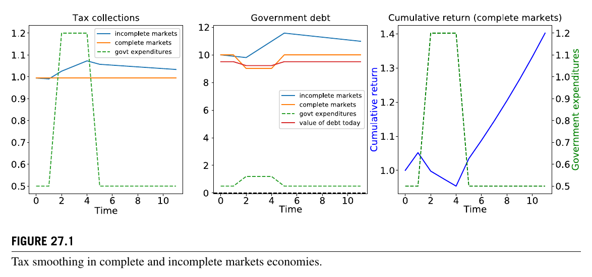
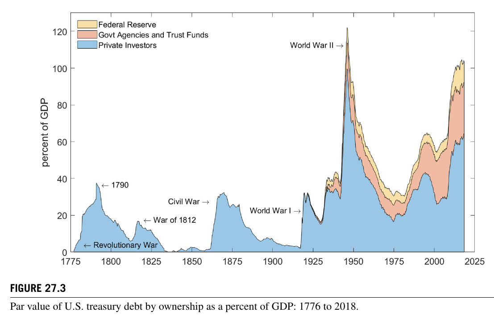
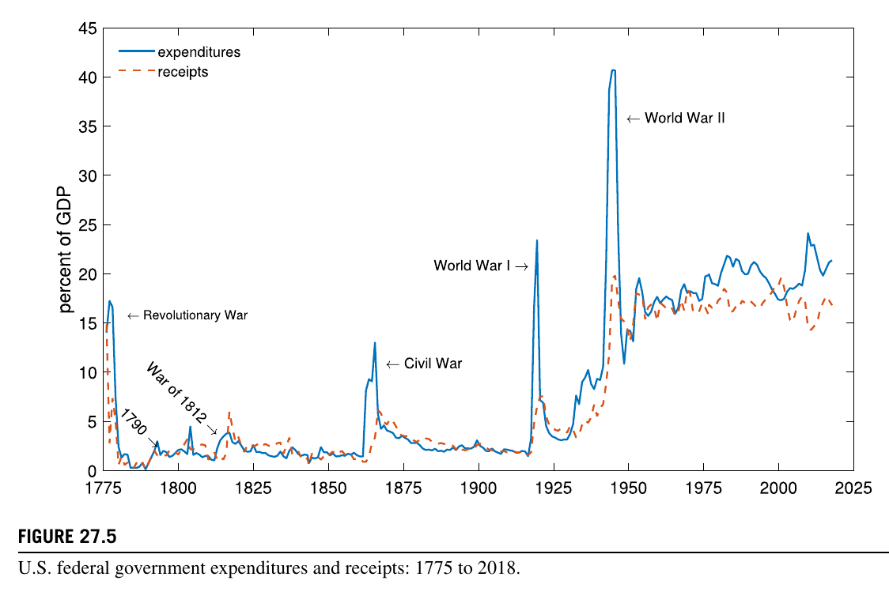
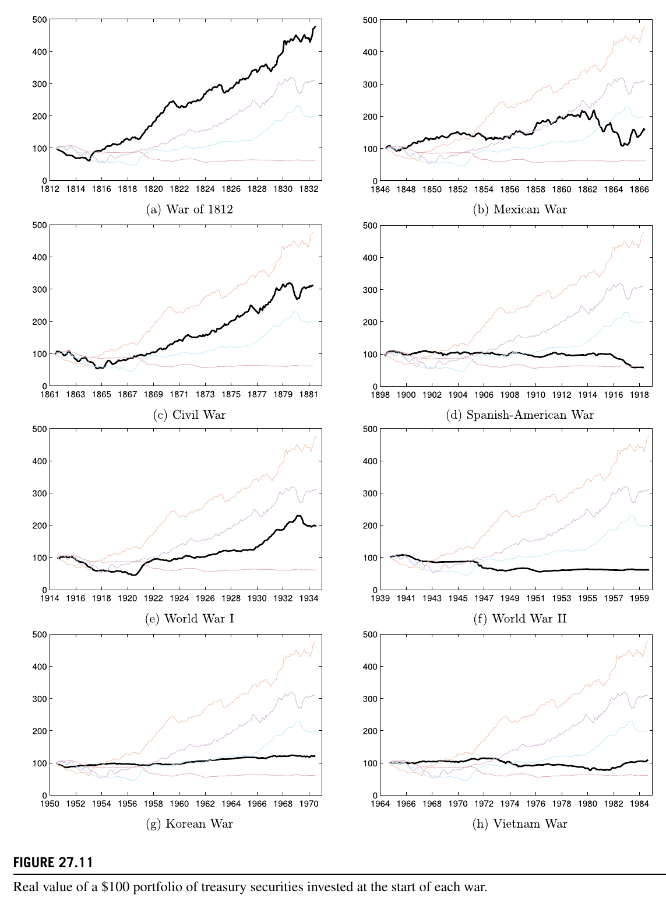
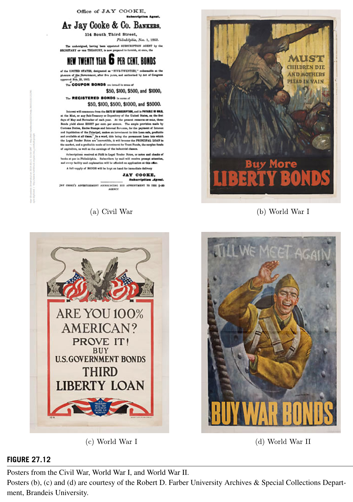
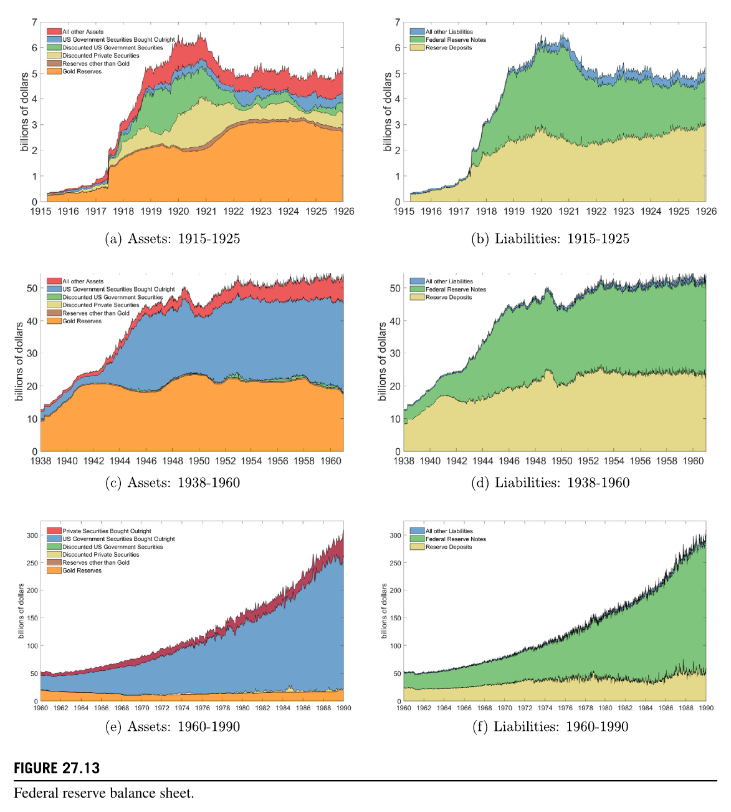

# 第27章 美国八次参战与两次叛乱中的债务和税收

**作者**：

- George J. Hall. Brandeis University, Waltham, MA, United States.
- Thomas J. Sargent. New York University, New York, NY, United States.

**原文引用信息**：

> Hall, G.J., Sargent, T.J., 2021. Debt and taxes in eight U.S. wars and two insurrections. In: Bisin, A., Federico, G. (Eds.), 2021. *The Handbook of Historical Economics* (pp. 825–880). Elsevier. https://doi.org/10.1016/B978-0-12-815874-6.00036-8

## 简介

本章比较美国八场战争及两次叛乱期间和战后的财政选择，考察政府如何在税收、计息债务、货币发行和债权人的事后回报之间分摊战争成本。作者以 Gallatin-Barro 税收平滑模型和 Lucas-Stokey 状态或有债务模型为基准，并以债务市值和持有期总回报进行预算分解。结果显示，从 1812 年战争到越南战争，税收承担的战争成本份额总体上升，债务份额下降，但只有南北战争接近纯暂时支出冲击下 Gallatin-Barro 模型建议的融资组合。1812 年战争、南北战争、第一次世界大战和朝鲜战争的债权人实际回报呈战时为负、战后为正的模式，方向上符合 Lucas-Stokey 模型；不过，只有朝鲜战争在开战时已有足够债务存量，并立即造成实际资本损失。战后债务/GDP 的下降也不能简单归结为经济增长：早期战争后主要依靠初级盈余和实际增长，二战以后通胀与增长更重要。债券条款、利率管制、征兵的隐性税以及纳税人与债权人的利益分化，说明两个模型只能作为组织历史证据的基准。

## 章节结构图

- 27.1 导论
  - 研究问题、历史学习与全章结论
- 27.2 战争融资的两种理论
  - Gallatin-Barro 税收平滑、Lucas-Stokey 状态或有债务、美国国债的状态或有回报
- 27.3 政府预算约束
  - 战时收入来源与战后债务/GDP 变化的分解
- 27.4 支出与税收
- 27.5 债券持有人的回报
- 27.6 债务设计、营销与管理
  - 1812 年战争、墨西哥战争、南北战争、西班牙—美国战争、第一次世界大战、第二次世界大战、朝鲜战争、越南战争
- 27.7 两次叛乱
  - 美国独立战争与南部邦联
- 27.8 限定与补充
- 27.9 附录 A：会计处理
- 27.10 附录 B：数据来源

## 27.1 导论

作者把本章称为一次延伸的“模式识别”练习，同时强调数据不会自行说话：跨战争的异同由第 27.2 节的理论和第 27.3 节的预算会计框架共同组织。理论既是规范基准，也有助于理解历史决策者的主张。典型例子是 Barro (1979) 模型与财政部长 Albert Gallatin 1807 年报告 (Gallatin, 1837) 的一致性：面对暂时的战争开支，应主要借债，增税只需覆盖和平时期支出、既有债务利息和新增贷款利息。

但融资模式也受战争目的、制度约束和决策者认知影响 (Becker, 1962)。过去的经验不断塑造后来的政策：大陆货币贬值使 1812 年战争时期的决策者警惕纸币融资；墨西哥战争后不可赎回债券升值，促使南北战争采用可赎回债券；一战后自由债券跌价的记忆则影响了二战和朝鲜战争时期的利率政策。债务展期风险、计价单位、银行与财政互动、违约诱惑，以及投资者等待更优条件的动机，都超出两个简化模型。

### 27.1.1 阅读指南

本章依次讨论理论、预算分解、跨战争结果、债券制度史和叛乱融资。八场战争是 1812 年战争、墨西哥战争、南北战争、西班牙—美国战争、两次世界大战、朝鲜战争和越南战争，另论美国独立战争和南部邦联。战争成本中的税收份额总体上升；铸币税在南北战争、两次世界大战和朝鲜战争中占有显著份额；战后债权人实际回报随时间下降；国债持有者虽从少数精英扩展到大众，更广泛的持有却未带来更高回报。

## 27.2 战争融资的两种理论

两个模型都让政府在随机支出冲击下选择税收和资产头寸，以最小化税收造成的跨期损失。损失函数 (27.1) 将各期税收的二次成本按折现因子 $\beta$ 加总；政府支出 $G_t=G(z_t)$ 由马尔可夫状态 $z_t$ 决定，未来支出的条件现值记为 $H(z_t)$。两者的区别在于可交易资产和预算约束。

Barro 模型只允许交易一期无风险债券，固定总收益率为 $R=\beta^{-1}$。支出冲击由税收和债务数量吸收，债权人的事后回报不变；冲击越持久，税收调整越大。Lucas-Stokey 模型则允许交易一套完整的一期 Arrow 证券，即针对每种未来状态支付的证券。定价核为 $q(z_{t+1}|z_t)=\beta\phi(z_{t+1}|z_t)$，政府可通过状态或有的债务回报承保财政冲击，使税收在时间和状态之间完全平滑。为便于比较，作者令无风险一期回报与 Barro 模型相同，并排除原 Lucas-Stokey 模型中政府操纵均衡利率的机制 (Lucas and Stokey, 1983)。

### 27.2.1 Barro 模型中的最优税收—借债方案

最优税收规则 (27.14) 使税收服从随机游走：新的支出信息一旦改变未来政府支出的条件现值，税收便相应调整。连续状态例子把支出冲击分成永久成分和暂时成分。永久冲击由等额的永久增税吸收，不增加债务；暂时冲击主要转化为永久债务，仅以冲击的 $(1-\beta)$ 倍永久增税支付新增利息。若战争被视为一次性支出，模型便近似 Gallatin 的规则。图 27.2 中的一次性 50% 支出增长主要造成永久债务增加，税收仅小幅永久上升。

### 27.2.2 Lucas-Stokey 模型中的最优税收—借债方案

该模型的最优政策为 $T_t=T_0$：税收不随时间或状态变化，政府以状态或有资产组合吸收冲击。两状态马尔可夫例子中，一条先和平、经历三年战争、再恢复和平的样本路径使政府债务组合在战时产生负回报、和平时期产生正回报，累计回报呈“长柄勺”形。

连续状态例子同样把支出分为随机游走的永久成分与白噪声的暂时成分。式 (27.21) 显示，资产组合对永久支出创新的敏感度带有 $(1-\beta)^{-1}$ 的放大项，而对暂时创新的敏感度没有这一项；比较相同尺度的冲击时，永久冲击会给债权人带来大得多的状态或有资本利得或损失。

### 27.2.3 美国国债：无风险还是状态或有？

美国国债大多没有明示的状态或有条款，赎回权和转换权是少数例外。不过，价格水平、资本税率和利率变化仍会使名义固定债务产生状态或有的实际回报。二战以前，美国政府曾以战后通缩前景支持战时货币和债券融资。Bordo and Kydland (1995) 进一步把 1880—1914 年的金本位理解为一种规则：金本位国家可在战时暂停兑换、发行纸币和债券，并以战后按原平价恢复兑换的可信承诺补偿债权人。

## 27.3 政府预算约束

为把一期债券模型连接到期限各异的美国国债，预算约束 (27.22) 纳入计息债务市值、价值加权名义回报、政府购买、税收净额和基础货币变化。作者剔除美联储、政府机构和信托基金持有的债务，并以反映票息、当前利率和偿付概率的市值计量。债权人收益采用整个国债组合的价值加权持有期回报，而非财政部的“未偿债务利息支出”。

### 27.3.1 战时收入变化的分解

式 (27.24) 将政府支出和国债名义回报分解为税收、新增计息债务、货币创造、实际 GDP 增长对债务/GDP 的稀释、通胀对债务实际价值的侵蚀，以及交叉项。作者以战前和平时期为基准，加总战争期间各项对基准的偏离，得到式 (27.27) 和表 27.1。与直接加总特定军费的旧方法相比，这一分解把预算各项偏离既有趋势的部分归于战争，并计入增长和通胀。

若净实际利率为 6%，支出冲击又纯属暂时，Gallatin-Barro 方案意味着债务融资 94%、增税融资 6%。八场战争中，只有南北战争接近这一比例：增税承担 6.8%，计息债务、货币增长和通胀合计承担约 91%。从 1812 年战争到越南战争，税收份额由 -32.9% 升至 40.8%，债务份额由 148.5% 降至 12.9%；西班牙—美国战争因时间极短、成本最低而偏离这一趋势。1812 年战争的负税收份额并非没有征税，而是关税收入低于和平基准。

除墨西哥战争和朝鲜战争外，通胀贡献都大于国债名义回报的增加，与战时负实际回报一致。一战战争成本相当于一年 GDP 的 37%，税收承担 21%，债务和货币增长承担 82%，与 Goldin (1980) 接近。传统研究因朝鲜战争期间债务存量几乎不变、预算平衡而称其完全由税收融资；本章以战前本应持续的二战债务偿还为反事实，认为战争取消初级盈余、推迟去杠杆，债务和货币增长因而承担 45.5%。

### 27.3.2 战后债务/GDP 变化的分解

式 (27.28) 将战后债务/GDP 的变化分为名义回报、实际 GDP 增长、通胀、初级赤字、交叉项、铸币税和残差。除越南战争外，政府在战后约 12—15 年均降低了债务/GDP，这不同于两个基准模型让暂时战争债务长期保留的简化结果。

从独立战争债务重组到一战，压低战后债务/GDP 的最大力量通常是初级盈余，其次是实际增长；正的名义回报抵消部分下降。1812 年战争、南北战争和一战的战时通胀之后出现通缩，提高债务实际价值并给债权人较高回报。二战、朝鲜战争和越南战争后，通胀与实际增长比初级盈余更重要。1946 年 6 月二战价格管制解除后的 24 个月内，价格水平上升 46%，实际侵蚀了接近一半的债务。越战后，1980 年代初 Volcker 抑制通胀带来的高债券回报则推动债务/GDP 上升。

## 27.4 支出与税收

南北战争和两次世界大战期间，支出骤增而税收增幅较小；战后支出下降，税收仍处高位，政府多年保持初级盈余。这符合暂时冲击下的税收平滑，但战争也永久改变政府规模与支出构成：1812 年战争后军事支出占 GDP 比例提高；南北战争后养老金长期增加；一战后“民事”项目维持高位；二战则使联邦支出由战前不足 GDP 的 10% 升至战后约 20%。Edwards (2014) 估计，每增加 1 美元战时支出，随后八十年的退伍军人及遗属福利支出现值约增加 0.5 美元。作者以 $\beta=.95$、$\rho=.35$ 的一阶自回归支出过程匹配这一战时与战后支出比例；在该校准下，Barro 模型仍建议约 93% 的战时支出由债务融资。

税种也随战争变化。南北战争前联邦收入主要来自关税；战争中引入所得税等国内税，战后虽撤销部分税种，酒类和烟草税仍使关税与国内税收在此后半世纪大致并重。1914 年恢复所得税、一战提高税率后，国内税收成为主要来源；1942 年《收入法》奠定现代个人和公司所得税体系。早期三场战争债务主要靠关税偿付，南北战争和西班牙—美国战争债务靠关税及酒、烟税，一战以后则主要靠个人和公司所得税。

表 27.3 显示，除战前经历经济下行的南北战争和二战外，其余战争前政府通常有初级盈余。1812 年战争和墨西哥战争中，关税下降使税收/GDP 低于战前；其余六场战争的税收/GDP 都上升，但增幅小于支出/GDP，符合广义的税收平滑。除西班牙—美国战争外，战后十年的平均支出与税收占 GDP 比例都高于战前五年。

## 27.5 债券持有人的回报

作者用两组可比序列检验 Lucas-Stokey 机制：战争开始后二十年的价格水平，以及将 100 美元持续再投资于全部未偿国债并按市值重平衡所得的实际组合价值。1812 年战争、墨西哥战争、南北战争和一战都出现战时物价上涨、战后物价回落，实际国债组合价值路径也不同程度地呈“长柄勺”形；墨西哥战争的形状很弱，而且表 27.4 报告的战时平均年化实际持有期总回报仍为正，为 3.95%。1812 年战争、南北战争和一战的战时年化实际回报分别为 -10.58%、-5.69% 和 -8.60%，战后十五年则为 12.01%、8.47% 和 5.52%。朝鲜战争没有战后通缩，但同样出现战时负、战后正的实际回报。

战后债权人回报随时间下降：从 1812 年战争后的 12.01%，降至南北战争后的 8.47%、一战后的 5.52%，再到二战后的 -1.42%。美国 1933 年退出金本位后，最近三场战争的战后实际累计回报近乎平坦。图表也印证 Friedman (1952) 的判断：二战物价上涨慢于一战和南北战争；二战国债的名义持有期回报约为 2%，符合 Samuelson (1945) 所称的“2% 战争”。

## 27.6 债务设计、营销与管理

四场成本最高的战争暴露出两个模型忽略的问题：潜在债权人若预期战争扩大将推高通胀和利率，便可能延迟购买长期债券；债券条款又会在财政部与投资者之间分配利率风险。1776—1920 年间，国会逐项决定国债条款；一战后逐渐授权财政部，到 1939 年债务设计和管理几乎全部转交财政部。债券市场也由少数精英扩展到普通家庭。

### 27.6.1 1812 年战争

Jefferson 政府撤除国内税制，禁运又重创关税收入，美国开战时准备不足。东北商人反战，国会也未建立可信偿债收入，长期债券只能折价出售。Gallatin 承诺，若后来借款条件更优，早期认购者可获同等待遇。1814 年一笔 2,500 万美元、票息 6% 的贷款大部取消；其中“一千万美元贷款”实际筹得约 794 万美元，却增加约 992 万美元面值债务，财政部按面值接受市值较低的私人银行券又使实际收入更少。战后履约和物价下降使此后十五年债权人年均实际回报达到 12%。

### 27.6.2 墨西哥战争

长期经济增长及联邦政府偿还旧债建立的信誉，使财政部得以用更好条件向国内投资者借款，债券以硬币支付且需求充足。但利率随后下降，票息 6%、十年或二十年内不得赎回的长期债券升水，政府用盈余回购时成本高昂。Dewey (1912) 所称的这一判断失误，直接推动南北战争采用附赎回权的债券。

### 27.6.3 南北战争：7-30 与 5-20 债券

财政部长 Salmon Chase 推出附赎回权的长期债券，并将销售对象从东北金融机构扩展到全国中产家庭。1861 年三年期“7-30”国库券票息 7.3%，最低面额 500 美元。军事失利和新增借款使银行拒绝按面值认购，政府与主要银行相继停止硬币支付。1862 年《法偿法》授权发行不可兑换黄金的绿钞，海关收入和国债票息则仍以硬币支付；绿钞贬值后，财政部可按其面值出售债券。

同一法律授权票息 6%、二十年到期、五年后可按面值赎回的“5-20”债券。Chase 聘请 Jay Cooke 建立全国代理网络，以爱国主义广告、十美元最低认购额和分期付款吸引工薪与中产家庭。法律只明确票息以金币支付，本金的计价单位直到 1869 年《加强公共信用法》才确定为黄金或等值货币。战后联邦政府履约，1866—1881 年债权人年均实际回报为 8.5%。由于到期债务远超财政收入，政府实际通过发行新证券展期。

### 27.6.4 西班牙—美国战争：1908—1918 年 10-20 债券

这场三个月战争只发行一种票息 3%、二十年到期、十年后可赎回的债券。国会按面值向公众发行 20—300 美元面额债券，优先满足个人投资者，既回应此前依赖 J.P. Morgan 和 August Belmont 财团承销的不满，也把广泛认购视为支持战争的信号。发行被超额认购；Garbade (2012) 指出，若采用拍卖，债券本可高于面值成交，政府以放弃部分收入换取了政治信号。

### 27.6.5 第一次世界大战：转换权与美联储“借款并购买”

财政部长 William McAdoo 按次序发行五种“自由债券”，并以全国集会、电影明星和海报直接面向公众推销。美联储的“借款并购买”计划鼓励个人向银行借款认购，银行再以优惠贴现率向美联储融资；基础货币扩张构成铸币税收入。首两期债券允许在后续票息提高时转换，以保护投资者免受利率上升损失。

这些安排仍不足以避免战后亏损。到 1920 年，债券价格跌至每 100 美元面值约 85—91 美元；以短期银行贷款购买长期国债的小投资者承受了杠杆化损失。债券认购率较高地区战后转向共和党的幅度也更大 (Hilt and Rahn, 2018)。财政部扩大了国债持有群体，却留下投资者感觉受骗的政治记忆。

### 27.6.6 第二次世界大战：非流通债务、固定收益率曲线与美联储支持

财政部长 Henry Morgenthau Jr. 为避免重演一战后的损失，建立非流通储蓄债券，与美联储钉住并压平名义收益率曲线，并让美联储直接购买有价证券。储蓄债券不得转让，却可按预定价格赎回，因而兼具流动性且不会产生名义亏损；1941 年 5 月至 1946 年 1 月，超过 8,500 万人购买了 547 亿美元，1945 年底占国债面值 17% 以上。

1942 年，财政部与美联储把长期国债利率上限设为 2.5%，三个月期国库券设为 0.375%，中间期限沿向上倾斜的收益率曲线插值。价格管制虽执行不完善，但至少从官方价格指数看放慢了物价上涨。私人投资者因此偏好长期债券，美联储则成为短债主要买家；战后取消价格管制，通胀使集中持有长期债券的私人投资者承受较大实际损失。

### 27.6.7 朝鲜战争与财政部—美联储协议

开战时私人持有的联邦债务相当于 GDP 的 66.5%，具备实施 Lucas-Stokey 式开战资本损失的条件，但 Truman 反对让债权人亏损。消费者因记忆二战配给而抢购，物价上涨仍首次在美国战争开始时立即给债权人造成小幅实际资本损失。美联储继续购债以固定收益率曲线、托住价格，却与控制通胀的目标冲突。1951 年 3 月的财政部—美联储协议结束了维持债券价格下限的承诺。朝鲜战争新增债务很少，战后十五年国债组合年均实际回报也只有 1.13%。

### 27.6.8 越南战争

1950 年以后，财政部提高证券标准化程度，缩短平均期限，更规则地安排到期结构，附赎回权长期债券的比重明显下降。截至 1974 年 12 月，国库券、票据和债券三类有价证券共有 120 种具体证券，销售与到期安排已能避免债务集中到期。

## 27.7 两次叛乱

作者另论成功的美国独立战争和失败的南部邦联分离。两者无法完全纳入八场战争的比较：新政权开战时没有成熟的税收和债务制度，战争又关乎政权存亡，相关数据也不完整。大陆会议、邦联政府和南部邦联均呈州强中央弱的结构，州掌握征税权却不愿足额汇款，中央政府只能靠巨额赤字取得资源。

大陆政府 1775—1780 年几乎完全依赖发行无息大陆币取得铸币税，流通面值最高约 2 亿美元。货币相对其承诺兑换的西班牙银元迅速贬值，1780 年兑换比率从一比一改为四十比一，1790 年再按 Hamilton 的建议改为一百比一。大陆币崩溃后，政府才大量发行计息的贷款局凭证和债务凭证；后者常由军需和粮秣官交给被征用物资的平民，但发行记录并不完整。南部邦联则从开战起混合发行计息债券和无息邦联元，第二年计息债务发行超过无息债务两倍，后期日益依赖货币。财政部长 Christopher Memminger 还成功使邦联元成为境内计价单位。两次叛乱的价格水平均上涨近 500%，远高于前述八场战争。

两个政府最终都没有按原承诺偿付无息票据，但计息债权人的结果不同。1790 年 Hamilton 主持的分类重组使大陆时期计息债权换得市值约为原承诺 75% 的新证券；南部邦联各类证券持有人则未获偿付，债券随战局下跌并最终一文不值。美国宪法第十四修正案第四节还禁止联邦或各州承担为叛乱发行的债务。

## 27.8 限定与补充

预算约束只列税收、债务和货币三种显性收入，未计国有化、物资征用和征兵。征兵是一项重要隐性税：被征者以低于市场工资服役，税额等于其民间工资与军饷之差；数据不足使作者无法构造跨战争一致估计。

两个模型还假定战争是外生支出冲击，纳税人与债权人是同一群体，政府只关心扭曲性税收的无谓损失。现实中，政府可以选择是否开战，军人与后方人群承担的风险不同，纳税人与债权人也可能利益冲突。Smith (1776) 指出，借债能以较小且不显眼的增税维持战争；Zielinski (2016) 和 Kreps (2018) 也认为，公众支持越弱，政府越倾向借债以降低战争成本的可见度。财政部长期把广泛购债视作爱国支持，“战争税”主张者则认为增税才是检验支持的可信方式。Rumbaugh (2013) 主张军事行动自动触发加税，即战时集中加税（tax-bunching），而非税收平滑。

公平争论同样没有单一答案。Sprague (1917) 认为借债使服役者先承担军旅牺牲，回国后又缴税偿债；朝鲜战争时期 Sam Rayburn 和财政部长 James Snyder 也以“共同牺牲”为加税辩护。Mellon (1924) 则认为，纯国内债务只是居民之间的负债与资产，国家已在战争发生时承担真实资源成本，借债只是重新安排谁先支付、谁以后获偿。Barro (1974) 列出了债务与税收融资等价的条件。

最后，两个模型假定跨期承诺会得到履行，民主制度中的承诺却只有在未来多数愿意尊重时才可持续。联邦政府在南北战争后实现了债权人的高实际回报，南部邦联债权人却因战败和宪法禁令损失全部资产。债券的事后回报不仅是通胀和利率的技术结果，也取决于未来政治联盟是否承认旧承诺。

## 27.9 附录 A：会计处理

附录以各未来日期一美元无风险索取权的价格说明，国债市值等于各期票息与本金承诺的贴现价值之和。面值既漏计票息，又未以市场贴现因子折算远期本金；前者使面值低估市值，后者使其倾向于高估市值，因此两者没有固定大小关系。价值加权持有期回报也不同于财政部的“未偿债务利息支出”：后者在 1929 年前只计票息，此后再加一期零息国库券收益，并非包含证券价格变化的投资者回报。

## 27.10 附录 B：数据来源

债券价格和数量来自 Hall et al. (2018)、CRSP 国债文件及 Gurkaynak et al. (2007) 的零息收益率曲线。名义 GDP 与 GDP 平减指数来自 MeasuringWorth；跨战争预算表采用年度平减指数，其余回报计算采用 Craighead (2010) 的月度价格指数。1790—1940 年财政收支来自历年财政部长报告，1934—2018 年来自管理和预算办公室；财政年度数据与内插后的 GDP 对齐。货币供应量由无息国库债务和美联储信贷组成。

### 27.10.1 1790 年以前

大陆政府 1776—1781 年支出来自 Joseph Nourse 整理的账目，1781—1789 年支出和 1790 年前收入来自 Robert Morris。贷款局凭证发行由国家档案馆原始账册重建；大陆币净发行来自 Grubb (2008, 2012)，并按 Bullock (1895) 的贬值表折算。

### 27.10.2 南部邦联

邦联收支来自 Christopher Memminger 的八份财政报告，以邦联元计价，并按 Schwab (1901) 的黄金—邦联元汇率换算和年化。报告止于 1864 年 10 月，且把票息与本金合称为“债务支付”，数据并不完整。债务发行图另按 Todd (1954) 换算为黄金美元，债券价格来自 Burdekin and Weidenmier (2003)。

### 27.10.3 美联储资产负债表

美联储周度数据来自 1915—2018 年《联邦储备公报》中十二家联邦储备银行的资产负债表。作者手工录入资料，后来发现 Bao et al. (2018) 已提供相同数据。附录还解释 1917 年法定黄金准备金调整对黄金、联邦储备券和银行准备金分类的影响，以免把会计重分类误作真实流量。

## 部分参考文献

- Barro, R.J., 1974. Are government bonds net wealth? Journal of Political Economy 82 (6), 1095–1117.
- Barro, R.J., 1979. On the determination of the public debt. Journal of Political Economy 87 (5), 940–971.
- Bordo, M., Kydland, F., 1995. The gold standard as a rule: an essay in exploration. Explorations in Economic History 32 (4), 423–464.
- Edwards, R.D., 2014. U.S. war costs: two parts temporary, one part permanent. Journal of Public Economics 113, 54–66.
- Friedman, M., 1952. Price, income, and monetary changes in three wartime periods. The American Economic Review 42 (2), 612–625.
- Gallatin, A., 1837. Report on the Finances November, 1807. Reports of the Secretary of the Treasury of the United States, vol. 1.
- Garbade, K., 2012. Birth of a Market: The U.S. Treasury Securities Market from the Great War to the Great Depression. MIT Press, Cambridge, MA.
- Goldin, C.D., 1980. War. In: Porter, G. (Ed.), Encyclopedia of American Economic History: Studies of the Principal Movements and Ideas, v. 1. C. Scribner’s Sons, pp. 935–957.
- Hilt, E., Rahn, W.M., 2018. Financial Asset Ownership and Political Partisanship: Liberty Bonds and Republican Electoral Success in the 1920s. NBER Working Papers 24719. National Bureau of Economic Research, Inc.
- Kreps, S.E., 2018. Taxing Wars: The American Way of War Finance and the Decline of Democracy. Oxford University Press.
- Lucas, R.J., Stokey, N.L., 1983. Optimal fiscal and monetary policy in an economy without capital. Journal of Monetary Economics 12 (1), 55–93.
- Mellon, A., 1924. Annual Report of the Secretary of the Treasury on the State of the Finances. United States Department of the Treasury, Washington DC.
- Rumbaugh, R.R., 2013. A tax to pay for war. The New York Times February 11, A19.
- Samuelson, P.A., 1945. The effect of interest rate increases on the banking system. The American Economic Review 35 (1), 16–27.
- Smith, A., 1776. An Inquiry into the Nature and Causes of the Wealth of Nations. McMaster University Archive for the History of Economic Thought.
- Sprague, O.M.W., 1917. Loans and taxes in war finance. The American Economic Review 7 (1), 199–213.
- Zielinski, R.C., 2016. How States Pay for Wars, 1 edition. Cornell University Press.
