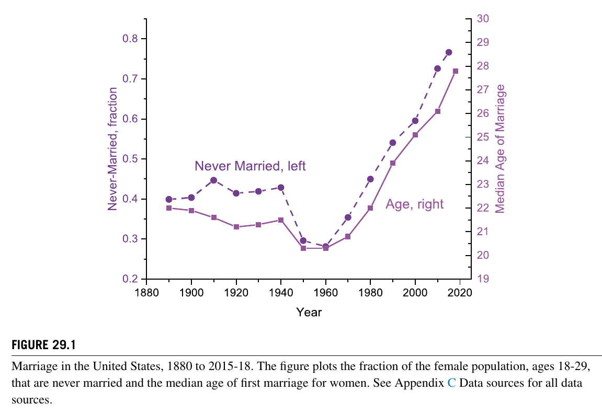
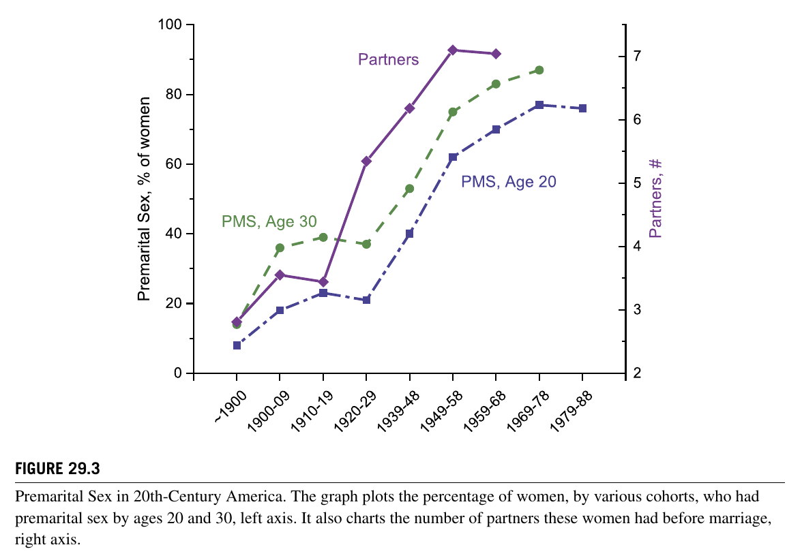
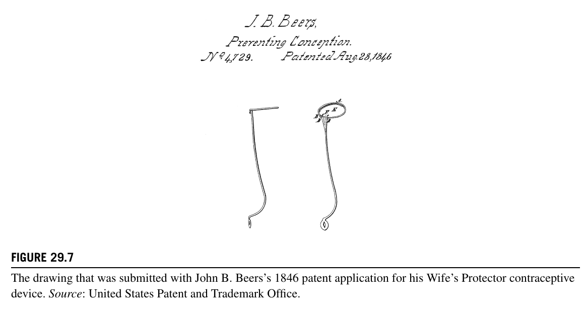
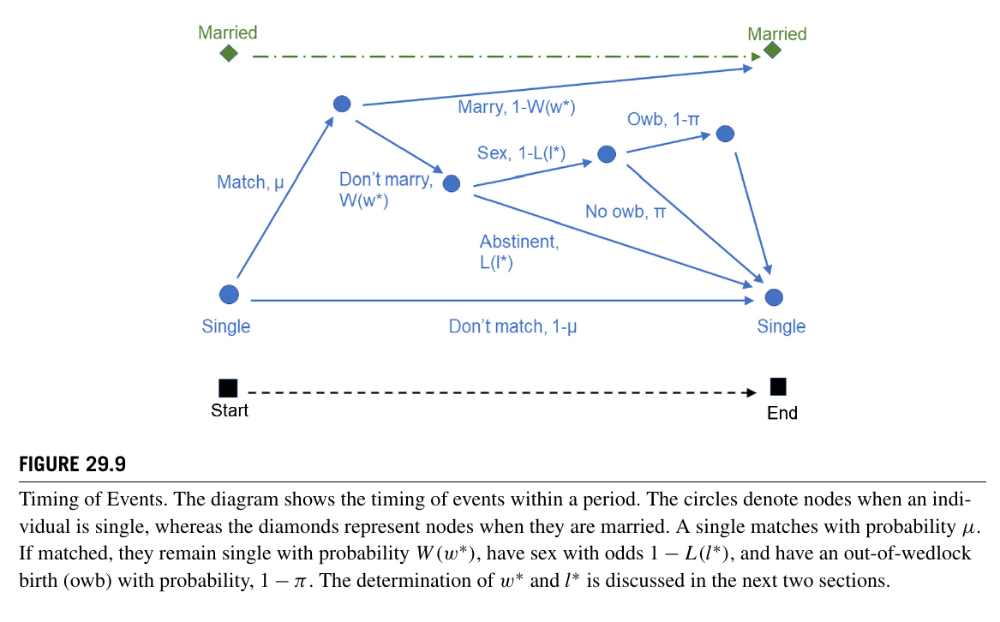
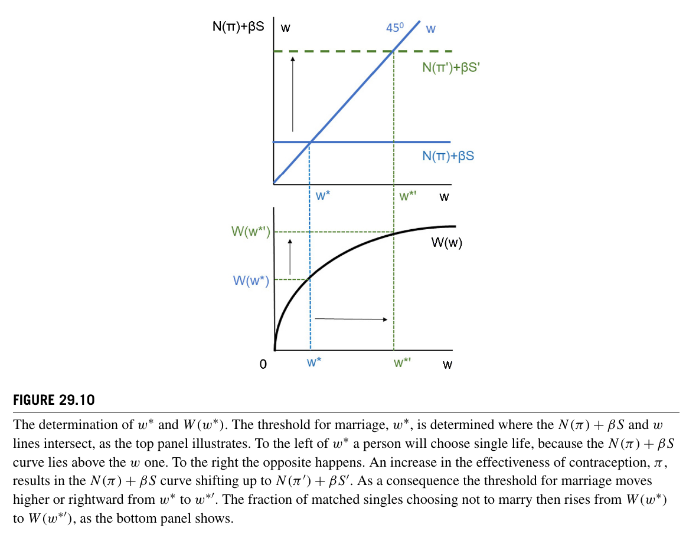
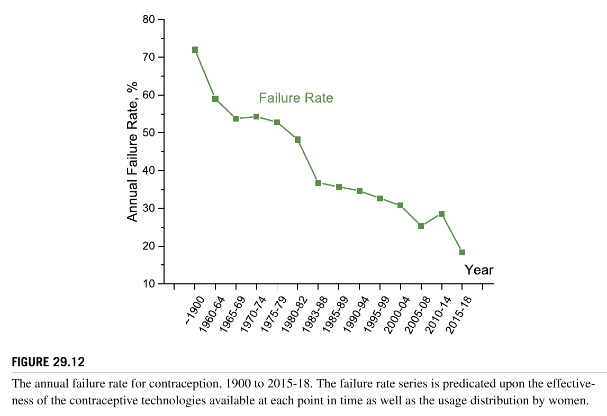

# 第29章 “妻子的保护者”：一种将避孕技术与婚姻衰退联系起来的量化理论

**作者**：

- Jeremy Greenwood. University of Pennsylvania, Philadelphia, PA, United States.
- Nezih Guner. CEMFI, Madrid, Spain.
- Karen A. Kopecky. Federal Reserve Bank of Atlanta, Atlanta, GA, United States.

**原文引用信息**：

> Greenwood, J., Guner, N., Kopecky, K.A., 2021. The wife’s protector: A quantitative theory linking contraceptive technology with the decline in marriage. In: Bisin, A., Federico, G. (Eds.), 2021. *The Handbook of Historical Economics* (pp. 903–943). Elsevier. https://doi.org/10.1016/B978-0-12-815874-6.00037-X

## 简介

本章以美国二十世纪婚姻率下降和初婚年龄上升为对象，考察避孕技术进步能否同时解释婚姻推迟、婚前性行为增加、性伴侣增多以及非婚生育上升。作者先回顾避孕知识的传播和安全套、子宫内避孕器、避孕药等技术的改进，再建立一个婚姻搜寻模型：单身者遇到伴侣后，可在结婚、禁欲的非婚关系和有性行为的非婚关系之间选择；非婚性行为可能以概率 $1-\pi$ 导致生育，并带来效用成本。避孕越有效，非婚性关系的预期成本越低，单身生活的价值越高，个人因而提高结婚对象的门槛并更可能发生婚前性行为。模型由此推出未婚人口比例和平均婚龄上升，婚姻年龄中位数不下降；非婚生育则可能因避孕失败率下降与性行为增加这两股相反力量而增减不定。作者以四个月为一期，分别校准约 1900 年和 2000 年的稳态；两期的偏好、匹配和分布参数相同，避孕安全概率与存活率按各期数据设定，其中核心变化是避孕失败率大幅下降。模型较好复现了初婚推迟、婚前性行为、非婚生育和婚前性伴侣数量的长期变化，但并非逐项精确拟合。最后，作者把这一机制置于更广泛的婚姻研究中，与女性工资、家务技术、福利制度、可婚男性供给和性别比等解释并列，因而提出的是避孕技术对婚姻衰退的量化解释，而非唯一原因。

## 章节结构图

- 29.1 导言
  - 29.1.1 量化理论史：若干例子
- 29.2 婚姻衰退
- 29.3 十九和二十世纪的避孕
  - 29.3.1 信息传播
  - 29.3.2 技术进步
- 29.4 模型设定
- 29.5 结婚还是单身生活？
- 29.6 禁欲还是非婚性关系？
- 29.7 统计力学
  - 29.7.1 按年龄划分的婚姻
  - 29.7.2 婚前性行为
  - 29.7.3 性伴侣数量
  - 29.7.4 非婚生育
- 29.8 校准
  - 29.8.1 程序
  - 29.8.2 避孕失败率
  - 29.8.3 结果
  - 29.8.4 打开黑箱
- 29.9 结论
- 29.10 文献综述
  - 29.10.1 避孕与结婚年龄
  - 29.10.2 婚前性行为与非婚生育
  - 29.10.3 影响结婚时机的其他因素
    - 工资上升
    - 家务技术
    - 福利国家
    - 缺少可婚男性
    - 性别比变化
- 29.11 附录 A：Beers 的专利说明书
- 29.12 附录 B：理论
- 29.13 附录 C：数据来源
  - 29.13.1 图表
  - 29.13.2 避孕措施的使用
  - 29.13.3 避孕措施的有效性

## 29.1 导言

技术既通过大型工业革命重塑生产，也可能通过看似微小的发明改变家庭生活。电力、内燃机和家务机械化减少了体力劳动和家务劳动，推动城市化及女性就业；计算机、互联网和人工智能则进一步改变工作、交往与择偶。抗生素延长寿命之后，教育、劳动参与、退休和储蓄也随之变化。作者把避孕视为另一项后果深远的“小发明”，并提出本章的问题：二十世纪避孕技术进步在多大程度上促成了婚姻衰退？

作者采用“量化理论史”（quantitative-theoretic history）回答这一问题。这一方法先提出历史问题和叙事背景，再从个人效用最大化或企业利润最大化出发建立模型，分析其机制和理论命题，最后模拟或校准模型，检验它能否解释相关历史事实，必要时再进行反事实实验。它把经济史的数据与观念同现代宏观经济学的模型工具结合起来。

### 29.1.1 量化理论史：若干例子

作者列举的早期研究包括战争融资和工业革命。Cooley and Ohanian (1997) 与 Ohanian (1997) 比较战争时期税收和债务融资；Greenwood and Yorukoglu (1997) 则研究三次工业革命，刻画新技术价格骤降、生产率暂时放缓和收入不平等上升等转型特征。后续研究把同类方法用于大萧条、从土地密集型生产向资本密集型生产的转变、社会保障的兴起、美国长期生育率下降、退休增加、汽车普及与郊区化，以及美国西部扩张。它们共同说明，量化理论不是单纯拟合时间序列，而是把明确的历史机制转化为可计算模型，再判断该机制在数量上是否足以解释事实。

## 29.2 婚姻衰退

美国年轻女性的婚姻状态在二十世纪显著变化。18—29 岁女性中从未结婚者的比例由 1900 年的 40% 升至 2015 年的 77%，女性初婚年龄中位数则由 22 岁升至 28 岁。同期婚前性行为明显增加：约 1900 年出生的女性只有 8% 在 20 岁前有过婚前性行为，1978—1988 年出生者则为 76%；约 1900 年出生的女性婚前平均有 2.8 名性伴侣（包括后来的丈夫），1959—1968 年出生者为 7 名。非婚生育也持续上升，而且战后各成年年龄组均出现这一趋势，并非只发生在青少年中。

本章的假说是，避孕失败率下降降低了单身女性发生性关系的预期成本，改变了立即与现有伴侣结婚和继续寻找更合适对象之间的权衡。模型中，单身者每期在婚姻市场搜寻；遇到对象后可结婚，也可维持有性或无性行为的非婚关系。作者暂不考虑离婚，以突出避孕技术如何改变进入婚姻的门槛。由于避孕改善同时增加未婚人口和未婚者的性行为，非婚生育总量即使在单次性行为更安全时也可能上升。

## 29.3 十九和二十世纪的避孕

近代避孕沿两条路径发展：避孕知识的传播，以及避孕器具和药物的改进。已婚女性在现代避孕技术出现前就通过不完善的方法控制生育；美国白人女性总和生育率从 1800 年的 7.1 降至 2015 年的 1.9，而 1905—1909 年出生的女性在避孕药发明时已年过五十，其生育数量仍明显低于更早世代。这说明家庭长期借助流产、禁欲及婚前性行为的禁令与污名、粗糙的避孕方法、弃婴和杀婴，以及推迟结婚来限制生育。不过，这些办法对未婚女性而言风险尤其高。

### 29.3.1 信息传播

十九世纪的避孕知识传播常伴随法律风险。Francis Place 在 1823 年向伦敦工人夫妇介绍避孕海绵；Charles Knowlton 在 1832 年的小册子中推荐性交后冲洗，并因传播该书入狱；Robert Dale Owen 则在 1842 年倡导体外射精。二十世纪初传播加快。Margaret Sanger 于 1916 年开设美国第一家节育诊所，九天后即被警方关闭并因此入狱；法院在 1918 年允许医生提供避孕措施后，她于 1923 年开设了持续运营的诊所。Mary Stopes 于 1921 年在伦敦采取了类似行动。James F. Cooper 1928 年出版的医学著作进一步向医生系统介绍各种避孕方法及失败率。作者借这些材料强调，技术是否可用不仅取决于发明本身，也取决于信息能否传播和服务能否提供。

### 29.3.2 技术进步

安全套在十九世纪已投入市场，但价格、触感和质量控制都是问题；一项 1934—1935 年的研究发现，受检产品中破裂、孔洞或瑕疵合计达 59.1%，随后美国食品药品监督管理局开始监管质量。John B. Beers 于 1846 年为名为 “Wife’s Protector” 的隔膜式器具取得专利，本章标题即出于此。十九世纪还出现了宫颈帽和阴道隔膜；杀精剂从早期刺激性较强的配方，逐步发展到更安全的表面活性剂。

二十世纪的进展包括 Ernst Grafenberg 在 1920 年代研发的子宫内避孕器、Ogino 与 Knaus 对排卵周期的准确刻画，以及节律避孕法的改进。早期宫内器具容易造成感染，抗生素出现和材料改良降低了风险；1967 年的含铜 T 形宫内避孕器在形状、材料和避孕机制上均有突破。避孕药则建立在激素发现、Russell Marker 开发的更高效合成方法和可口服孕激素之上，于 1960 年获批；后来又可通过贴片、植入物和注射给药。

## 29.4 模型设定

每期有一个规模为 1 的新成年单身世代进入经济，个体每期以概率 $\sigma$ 存活，分析稳态。单身者以概率 $\mu$ 遇到伴侣；遇到后可结婚，也可维持有性或禁欲的非婚关系。禁欲关系提供当期效用 $a\geq 0$；性关系的当期愉悦 $l>a$ 从分布 $L(l)$ 抽取。若发生非婚性行为，以概率 $\pi$ 避免怀孕，以概率 $1-\pi$ 发生非婚生育并承担效用成本 $O$。结婚带来的终身效用 $w\geq 0$ 从分布 $W(w)$ 抽取；作出结婚决定时已经知道 $w$，但尚不知道当期非婚关系中的 $l$。婚姻是吸收状态，贴现因子 $\beta$ 已包含存活概率。

## 29.5 结婚还是单身生活？

记当期单身的预期终身效用为 $S$，已匹配但不结婚者的预期当期效用为 $N(\pi)$。个体在结婚效用 $w$ 与继续单身的价值 $N(\pi)+\beta S$ 之间选择，因此存在结婚门槛

$$
w^*=N(\pi)+\beta S.
$$

只有当 $w\geq w^*$ 时才结婚。单身价值由未匹配后继续等待，以及匹配后在结婚和不结婚间择优共同决定。作者证明，$N(\pi)$ 随安全性 $\pi$ 上升而增加，因此 $w^*$ 也随之上升：避孕改善提高继续单身的价值，使人们更挑剔，已匹配者的结婚率 $1-W(w^*)$ 因而下降（命题 29.1）。单身者和最终结婚者的预期效用都提高；前者受益于更安全的非婚性关系，后者则因能够等待而获得平均更理想的配偶。

## 29.6 禁欲还是非婚性关系？

已经决定不结婚的匹配者在禁欲效用 $a$ 与性关系的预期效用 $l-(1-\pi)O$ 之间选择。相应的性欲门槛为

$$
l^*=a+(1-\pi)O.
$$

当 $l>l^*$ 时发生性关系。避孕越有效，非婚生育的预期成本越低，$l^*$ 越低，因此单身者发生性关系的比例 $\mu[1-L(l^*)]$ 越高（命题 29.2）。已匹配单身者不结婚的当期预期效用同时因两项变化而上升：已有性行为者遭遇非婚生育的概率降低，更多人也由禁欲转向预期效用较高的性关系。作者据此证明 $N'(\pi)>0$（命题 29.3），从而补全避孕改善提高结婚门槛的机制。

## 29.7 统计力学

本节通过追踪一个世代随年龄增长的状态分布，推导年龄别婚姻、性行为、性伴侣数与非婚生育统计量。

### 29.7.1 按年龄划分的婚姻

若上期末有 $s_{j-1}$ 名单身者，则本期新婚人数为 $n_j=\mu[1-W(w^*)]\sigma s_{j-1}$；仍保持单身的人数取决于未匹配和匹配后拒绝结婚两种情况。避孕改善提高 $w^*$ 后，仍单身且当期匹配者在各年龄的条件结婚概率都下降，累计未婚人口比例因而上升（命题 29.4）。作者利用婚姻年龄分布的一阶随机占优证明，平均婚龄随避孕有效性提高而上升，婚姻年龄中位数则弱增，即可能上升，也可能保持不变（命题 29.5 及附录 B）。这一结果不只是条件结婚率下降的直接推论，因为平均年龄的分子和分母都会变化。

### 29.7.2 婚前性行为

一个世代中仍未发生性行为者的数量同时受两个门槛影响：$l^*$ 降低会使禁欲者减少，$w^*$ 上升却会扩大单身人口。对给定年龄的全部存活人口而言，仍未发生过性行为者的比例如何变化并不确定；但在该年龄仍单身的人口内部，作者证明有过婚前性行为的比例随 $\pi$ 上升（命题 29.6）。因此，避孕进步既延长平均单身期，也提高单身期间发生性行为的概率。

### 29.7.3 性伴侣数量

作者递推计算每个年龄拥有 $i$ 名婚前性伴侣的单身者人数：个体每期可能未匹配、匹配后禁欲，或匹配后保持单身并新增一名性伴侣。再结合各年龄结婚概率和存活率，可得到已婚者婚前性伴侣数量的分布与均值。理论上无法在一般分布下证明该均值必然随避孕有效性上升，但校准后的模型可以检验这一数量关系。

### 29.7.4 非婚生育

匹配单身者发生非婚生育的比例为

$$
o=(1-\pi)[1-L(l^*)].
$$

避孕改善一方面直接降低失败概率 $1-\pi$，另一方面通过降低 $l^*$ 增加性行为，两种力量方向相反；结果取决于性行为增加相对于避孕失败率下降的弹性。总人口中的非婚生育还取决于单身人口和匹配后仍不结婚者的比例，而这两者也会随 $w^*$ 上升。因此，非婚生育随避孕改善而上升并不构成悖论，但也不是模型无条件推出的结论。

## 29.8 校准

### 29.8.1 程序

量化分析比较约 1900 年和 2000 年两个稳态，一期为四个月。性欲 $l$ 服从 Weibull 分布，婚姻适合度 $w$ 服从指数分布。不含存活概率的贴现因子 $\delta$ 和婚姻适合度分布的均值 $\xi$ 依据外部信息或标准化设定，存活率 $\sigma$ 与避孕安全概率 $\pi$ 则按各期数据设定；禁欲效用 $a$、匹配率 $\mu$、非婚生育成本 $O$ 及 Weibull 分布的尺度和形状参数，则通过最小化模型预测与 18 个目标矩之间的相对误差选取。

目标矩包括两期的女性婚姻年龄中位数，15—24、25—34 和 35—44 岁女性曾婚比例，女性在 20、25 和 30 岁前发生婚前性行为的比例，每千名单身女性中的非婚生育数量，以及婚前性伴侣数量。除 $\sigma$ 和 $\pi$ 外，两期参数保持相同；由于 $\beta=\sigma\delta$，有效贴现因子 $\beta$ 也随 $\sigma$ 变化。这使模型将两期差异主要归于避孕失败率的变化，而不是分别为每一时期重新选择偏好参数。

### 29.8.2 避孕失败率

作者根据每一时期不同避孕方法的使用频率和各自年度失败率，构造综合失败率。该指标既反映可用技术及其有效性，也反映信息传播、服务供给和女性实际采用情况，并把未采用任何方法者包括在内。按正文和图 29.12 的标签，综合年度失败率从约 1900 年的 72% 降至 2015—2018 年的约 18%；用于加权的避孕使用率和失败率表的末行则标为 2015—2017 年。2000 年稳态采用 2000—2014 年平均的 28%。因此，模型中的“技术”并非单一器具的实验室有效率，而是实际方法组合下的总体避孕环境。

### 29.8.3 结果

模型把婚姻年龄中位数从 21.15 岁推至 25.44 岁，接近数据中由 21.9 岁升至 25.1 岁的变化。15—24 岁女性曾婚比例在数据和模型中都下降约 11 个百分点，但模型在两期都高估该年龄组的已婚比例，并在 2000 年低估 25—34 和 35—44 岁女性的曾婚比例。

模型也复现了婚前性行为的大幅增加，但在 2000 年预测过高：数据中 20 岁前有过婚前性行为的比例从 8% 升至 76%，模型则从 12% 升至 94%。每千名单身女性的非婚生育由 8.7 增至 44.3，模型由 3.4 增至 33.6；模型较好捕捉增量，但低估水平。婚前性伴侣数在数据中由 2.8 增至 7.0，模型由 1.18 增至 8.2。作者据此认为单靠避孕环境变化的模型可以在数量上同时产生这些方向一致且量级可观的变化，但表中偏差也表明它并未完整解释年龄别婚姻分布和所有水平差异。

### 29.8.4 打开黑箱

作者计算模型的 Jacobian，以弹性表示各目标矩对参数变化的局部反应。禁欲效用、匹配率、非婚生育成本及性欲分布参数对 1900 年性行为的影响大于对 2000 年的影响，因为后一个稳态中几乎所有匹配单身者都已有性行为，比例接近上限。相反，2000 年的婚姻统计对参数更敏感：当非婚性关系成本较低时，匹配率提高会增加等待更合适对象的机会，因而推迟婚姻；在 1900 年，等待期间的非婚性关系成本较高，同一变化反而使人略早结婚。Jacobian 分析由此说明，校准结果并非由每个参数机械对应一个目标，而是同一参数在不同避孕环境下通过门槛选择产生不同作用。

## 29.9 结论

家庭在现代避孕出现前已经控制生育，但婚前性行为对女性长期风险很高。十九和二十世纪避孕器具的改善与信息传播降低了这一风险。作者的婚姻搜寻模型表明，避孕失败率下降会降低已匹配单身者的结婚率、增加性活跃单身者及从未结婚者的比例，并提高平均婚龄、使婚姻年龄中位数不下降；非婚生育则可能因行为反应而上升。将模型用于 1900 年和 2000 年美国数据后，它能够同时产生婚姻下降、婚前性行为增加、非婚生育增加和婚前性伴侣增多等事实的大部分变化。作者据此认为，避孕技术进步是婚姻衰退的重要机制之一。

## 29.10 文献综述

### 29.10.1 避孕与结婚年龄

Ogburn and Nimkoff (1955) 早已指出避孕对结婚年龄可能有相反影响：它既可使年轻夫妇无需立即承担育儿成本而更早结婚，也可让未婚者在不生育的情况下发生性关系，从而削弱结婚动机。Goldin and Katz (2002) 强调避孕药使美国大学女性能够安排生育、提高专业教育投资回报，并因更多女性共同推迟婚姻而形成更厚的婚姻市场；其识别利用各州未婚年轻女性获得避孕药的法律差异。

作者认为，把变化完全归于避孕药可能夸大其作用：生育控制、婚前性行为和女性接受高等教育的上升均早于避孕药普及；Meyers (2017) 的重新检验也认为，避孕药对初婚和初育年龄作用较小，放宽堕胎限制的影响更大。另一方面，Edlund and Machado (2015) 发现，避孕药早期只向已婚者开放时，下调法定结婚年龄可诱使女性更早结婚，同时拉长结婚与初育之间的间隔；以色列体外受精可得性的提高则延长了女性的生育时间范围，与更晚婚和更多人力资本投资相关。

### 29.10.2 婚前性行为与非婚生育

Greenwood and Guner (2010) 的均衡匹配模型显示，在其量化分析中，更有效的避孕同时提高了发生性行为和怀孕的青少年比例。Akerlof et al. (1996) 则认为，避孕和堕胎的可得性削弱了怀孕后结婚的隐性承诺，导致“奉子成婚”减少和非婚初育增加；本章同时指出，该模型未解释男性为何会遵守这种非正式承诺。Kennes and Knowles (2019) 把女性既有子女数、性行为、避孕、堕胎和怀孕后结婚选择纳入重复匹配模型，强调有子女的单身生活相对婚姻的价值上升。

社会规范也会放大技术冲击。Fernandez-Villaverde et al. (2014) 认为，贫困社会通过污名约束婚前性行为，是因为非婚生育给家庭、教会和政府造成沉重负担；避孕使婚前性行为更安全后，维持污名的收益下降，规范因而逐渐放松。技术进步与污名弱化相互强化，共同推动婚前性行为和非婚生育上升。

### 29.10.3 影响结婚时机的其他因素

#### 29.10.3.1 工资上升

女性相对收入提高会降低传统婚姻中的专业化收益，并使女性更有能力等待理想对象。Regalia and Rios-Rull (2001) 的量化模型认为，二十世纪七十年代中期以来女性相对收入上升可以解释单身女性比例增幅的近 90%；Shephard (2019) 则把性别工资差距缩小与女性就业增加、男性就业减少、女性初婚推迟和夫妻年龄差缩小联系起来。女性工作经验回报提高和劳动收入波动上升，也分别可能通过推迟生育、增加婚姻承诺风险而推迟婚姻。

#### 29.10.3.2 家务技术

耐用家电和医疗进步减少家务与生育负担，促进女性就业，也削弱“丈夫挣钱、妻子持家”式婚姻的经济收益。Greenwood and Guner (2009) 把家庭生产纳入婚姻搜寻模型，认为家务技术改善可以解释离婚上升、婚姻下降和已婚女性劳动参与增加的重要部分。该机制也能解释婚姻率并非单调下降：技术与收入最初帮助年轻夫妇离开父母建立家庭，后来则使单身者也有能力独立生活。大学教育溢价上升与家务技术进步还会通过教育同类婚和已婚女性就业放大收入不平等。

#### 29.10.3.3 福利国家

面向单身母亲的社会救助可能提高带子女单身生活的相对价值，但跨时期、跨州政策差异提供的经验证据并不一致。结构模型通常预测降低福利会减少单身女性；Low et al. (2018) 也发现美国 1996 年福利改革增加了已婚女性，但作者并未把福利扩张视为已经得到一致支持的主因。

#### 29.10.3.4 缺少可婚男性

工资低迷、制造业衰落和监禁增加可能减少“可婚男性”的供给。美国州际证据显示，男性监禁率提高与女性曾婚概率下降相关；均衡搜寻模型进一步表明，如果黑人男性面对与白人相同的就业和监禁转移率，种族婚姻差距可缩小约一半。这一解释尤其适用于婚姻衰退在群体间不均衡的事实。

#### 29.10.3.5 性别比变化

单身男性与单身女性之比会同时影响匹配机会和婚内议价权。移民、人口繁荣或萎缩、监禁和战争都可能改变性别比。Angrist (2002) 利用二十世纪初不同族群的移民流量发现，男性供给增加改善女性结婚机会并降低女性劳动参与。简单模型却不能解释为何大世代中的男女婚姻率会同时下降，或为何一战后法国男性大量伤亡而男女婚姻率反而上升。相关研究通过年龄异质的定向搜寻、婚前投资和战争前累积的单身男性存量，说明性别比的作用取决于年龄结构、偏好和内生搜寻行为，不能只按男女总数机械推断。

## 29.11 附录 A：Beers 的专利说明书

附录复制了 John B. Beers 1846 年 “Wife’s Protector” 专利的完整说明书。该器具由覆盖油绸薄膜的椭圆环、连接部件和手柄构成，目的是覆盖子宫口、阻止精液进入。它为正文关于十九世纪避孕技术的叙述提供了一份直接的技术史材料。

## 29.12 附录 B：理论

附录证明命题 29.5。作者把不同年龄仍存活且未婚者的数量构造成婚姻年龄的分布函数，并证明结婚门槛 $w^*$ 上升使该分布按一阶随机占优意义右移。因此，婚姻平均年龄随 $w^*$、进而随避孕有效性 $\pi$ 上升；同一分布位移也意味着婚姻年龄中位数上升或保持不变。

## 29.13 附录 C：数据来源

### 29.13.1 图表

婚姻与生育数据主要来自 *Historical Statistics of the United States*、美国人口普查局、American Community Survey 和生命统计报告；婚前性行为及伴侣数量来自 Kinsey et al. (1953)、Wu et al. (2018) 和 National Health and Social Life Survey。作者逐项说明图表的年份覆盖、年龄口径和计算方法，尤其说明婚前性伴侣数把未来丈夫计算在内。

### 29.13.2 避孕措施的使用

避孕使用数据衡量首次婚前性行为时采用的方法。1985 年以前的序列沿用 Greenwood and Guner (2010)，1985—2008 年来自 Mosher and Jones (2010)，之后由作者根据 National Survey of Family Growth 计算。1995 年后调查允许报告多种方法，作者把各方法比例标准化，使之与采用任何方法者的总比例一致；“其他”包括阴道隔膜、宫颈帽、宫内避孕器、杀精剂、节律法、注射和植入物等。

### 29.13.3 避孕措施的有效性

年度失败率分别覆盖不采用方法、避孕药、安全套、体外射精和其他方法。各方法的失败率来自不同时期的避孕技术资料；因其他方法使用者较少，作者对其失败率作分期假设。综合失败率用各方法当年的使用频率加权，因而把技术有效性与采用结构合并为正文所用的避孕技术序列。

## 部分参考文献

- Akerlof, G., Yellen, J.L., Katz, M.L., 1996. An analysis of out-of-wedlock childbearing in the United States. The Quarterly Journal of Economics 111 (2), 277–317.
- Angrist, J., 2002. How do sex ratios affect marriage and labor markets? Evidence from America’s second generation. The Quarterly Journal of Economics 117 (3), 997–1038.
- Cooley, T.F., Ohanian, L.E., 1997. Postwar British economic growth and the legacy of Keynes. Journal of Political Economy 105 (3), 439–472.
- Edlund, L., Machado, C., 2015. How the other half lived: marriage and emancipation in the age of the Pill. European Economic Review 80 (C), 295–309.
- Fernandez-Villaverde, J., Greenwood, J., Guner, N., 2014. From shame to game in one hundred years: an economic model of the rise in premarital sex and its de-stigmatization. Journal of the European Economic Association 12 (1), 25–61.
- Goldin, C., Katz, L., 2002. The power of the Pill: oral contraceptives and women’s career and marriage decisions. Journal of Political Economy 110 (4), 730–770.
- Greenwood, J., Guner, N., 2009. Marriage and divorce since World War II: analyzing the role of technological progress on the formation of households. In: Acemoglu, D., Rogoff, K., Woodford, M. (Eds.), NBER Macroeconomics Annual 2008. University of Chicago Press, Chicago, pp. 231–276.
- Greenwood, J., Guner, N., 2010. Social change: the sexual revolution. International Economic Review 51 (4), 893–923.
- Greenwood, J., Yorukoglu, M., 1997. 1974. Carnegie-Rochester Conference Series on Public Policy 46 (1), 49–95.
- Kennes, J., Knowles, J.A., 2019. Single Mothers and Shotgun Weddings. University of Aarhus. Unpublished paper.
- Meyers, C.K., 2017. The power of abortion policy: reexamining the effects of young women’s access to reproductive control. Journal of Political Economy 125 (6), 2178–2224.
- Ogburn, W.F., Nimkoff, M.F., 1955. Technology and the Changing Family. Houghton Mifflin, Boston, MA.
- Regalia, F., Rios-Rull, J.-V., 2001. What Accounts for the Increase in the Number of Single Households? University of Minnesota. Unpublished paper.
